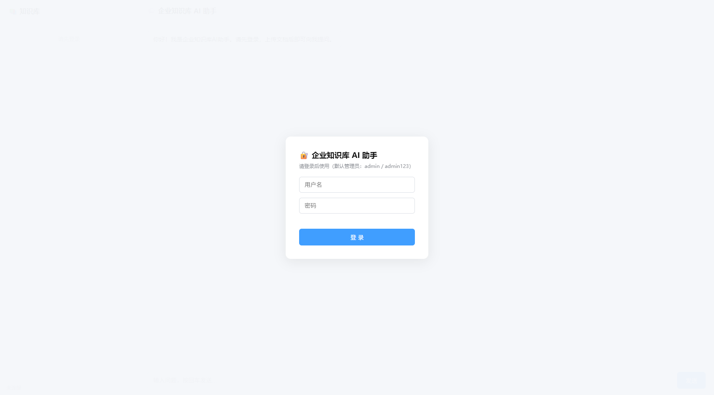
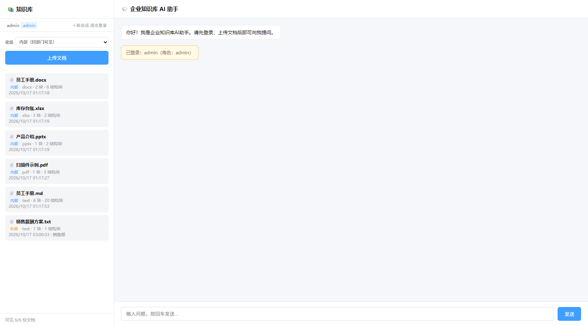
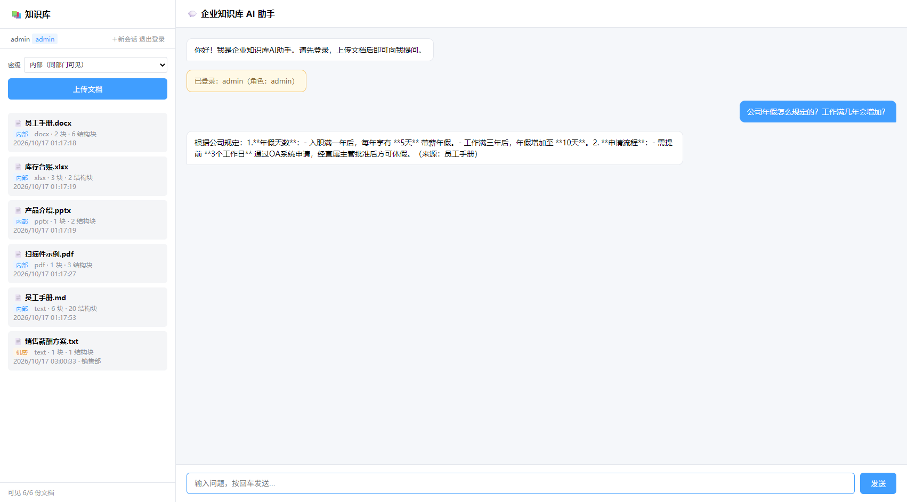
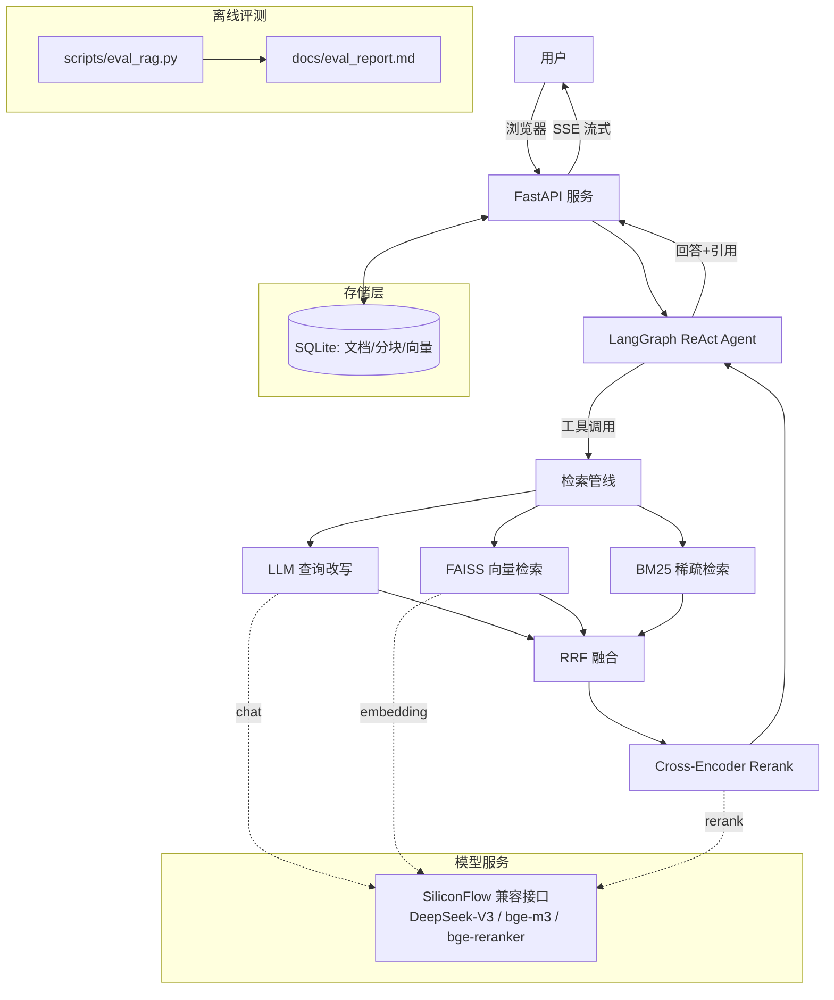

# 🧠 企业知识库 AI 助手（Agentic RAG）

> 基于「向量检索 + BM25 + RRF 融合 + Cross-Encoder 重排序 + LangGraph ReAct Agent」的企业级知识库问答系统。
> 支持 PDF/TXT/MD 文档上传、持久化存储、多轮会话、流式问答，并自带**离线检索评测体系与量化指标**。

    

## 📸 界面预览

| 登录（JWT 认证） | 文档管理（密级徽标） |
| --- | --- |
|  |  |

**多格式文档问答**（含 Word/Excel/PPT/扫描件 PDF，答案标注章节来源）：



---

## ✨ 核心特性

| 能力 | 说明 |
| --- | --- |
| 🚀 **Agentic RAG** | LangGraph ReAct 代理：知识库检索 / 数学计算 / 转人工 多工具自主决策 |
| 📄 **多格式解析** | 插件化解析子系统：Word / Excel / PPT（含备注）/ PDF / 扫描件 OCR / 图片 / CSV / HTML / JSON / 文本，共 19 种扩展名 |
| 🔎 **OCR 支持** | 扫描件判定 + PyMuPDF 渲染 + RapidOCR（离线、CPU 可跑），扫描件 PDF 与图片也能入库检索 |
| 🧱 **结构感知分块** | 按标题层级切分 + 表格语义化 + 块内注入「文档名 > 章节路径」上下文，引用可精确到章节 |
| ⏳ **异步解析流水线** | 大文件/OCR 转后台任务，上传接口立即返回 `task_id`，进度可查；解析结果按 MD5 缓存 |
| 🔍 **混合检索** | 稠密向量（FAISS 余弦）+ 稀疏检索（BM25 中文分词）双路召回 |
| 🧬 **RRF 融合** | Reciprocal Rank Fusion 无参融合多路结果，避免分数尺度不一致问题 |
| ✏️ **查询改写** | LLM 将问题改写为多角度查询（RAG-Fusion），提升长尾/口语化问答召回 |
| 🎯 **重排序** | bge-reranker-v2-m3 Cross-Encoder 精排 Top-20 → Top-5 |
| 💾 **持久化** | 文档/分块/向量/解析元数据落 SQLite，**服务重启自动恢复，不丢数据**（老库自动迁移） |
| ⚡ **流式输出** | SSE 分段推送（Agent 完成后按 12 字一段下发），前端打字机体验 |
| 📊 **评测体系** | **115 题评测集**（单跳/流程/口语化/跨段/不可答五类）+ 五种检索策略对比 + 分块策略 A/B 实验，产出 Hit@k / MRR 真实指标 |
| 🧪 **工程化** | 模块化分层、配置中心（无硬编码密钥）、**153 项单元测试**、健康检查、CI 质量门禁 |
| 🐳 **一键部署** | Docker / docker-compose 生产化部署，含健康检查与数据卷 |
| 🔐 **认证与权限** | JWT 登录（access/refresh）+ RBAC 四角色 + **文档级 ACL（user/role/dept）** + 密级标签（public/internal/confidential/secret） |
| 🛡️ **召回期权限过滤** | 权限在**检索候选生成阶段**生效（向量与 BM25 双路过滤），杜绝「先检索后过滤」导致的越权泄露 |
| 🧾 **审计日志** | append-only 记录登录/上传/删除/问答/授权变更（用户、IP、UA、查询原文、结果） |
| 🧠 **会话记忆** | 三层记忆：最近 K 轮工作记忆 + 滚动摘要（超阈值 LLM 压缩）+ 会话列表/重命名/删除/TTL；**重启不丢上下文** |
| 🧑‍⚖️ **端到端质量评测** | LLM-as-Judge 评「正确性 / 忠实度 / 相关性」，产出达标率与幻觉率，与检索指标互补 |
| 🔎 **引用级可验证** | 答案逐句对齐证据 `[E#]` 并做蕴含判定：**Citation Precision 91.7% / Recall 93.3%**，不支持的句子自动删除/拒答；10 道不可答题拒答率 100% |
| ⚖️ **冲突与时效** | 检测新旧制度/法规/行业参考的差异并**显式归因**（谁为准 + 理由）：15 道冲突用例**检测率 100%、归因准确率 100%** |
| ⚡ **语义缓存** | 相同/近似问题命中检索缓存：**实测约 16×（2.3s → 0.14s）**；键含权限范围指纹与索引版本，杜绝越权命中 |
| 🔬 **失败分类学** | 对 525 个检索评测点 + 24 题质量评测 + 9 次真实故障归因，产出 22 条带根因/修复/验证的失败档案（`docs/failure_taxonomy.md`） |

### 📄 支持的文档格式

| 类别 | 格式 | 说明 |
| --- | --- | --- |
| Office | `.docx` / `.xlsx` / `.pptx` | 保留标题层级、sheet 结构、**PPT 备注页**；表格自动语义化 |
| PDF | `.pdf` | 文本层优先；**扫描件自动判定并 OCR** |
| 图片 | `.png` `.jpg` `.jpeg` `.bmp` `.tif` `.tiff` `.webp` | 直接 OCR |
| 结构化/文本 | `.csv` `.tsv` `.html` `.htm` `.json` `.txt` `.md` `.markdown` | 保留表格/标题结构，JSON 展平为自然语言句 |

> 老格式 `.doc` 需外部 LibreOffice 转换，当前仅给出明确提示（未启用）。


## 🏗️ 系统架构



## 🛠️ 技术栈

| 层次 | 技术 |
| --- | --- |
| 后端框架 | FastAPI + Uvicorn + Pydantic v2 + SSE |
| Agent 编排 | LangGraph（ReAct）+ LangChain 工具调用 |
| 搜索 | FAISS（IndexFlatIP）+ rank-bm25（jieba 中文分词）|
| 模型 | DeepSeek-V3（对话/改写）/ BGE-M3（向量）/ BGE-Reranker-v2-M3（精排），硅基流动兼容接口 |
| 存储 | SQLite（WAL，持久化） |
| 工程质量 | pytest（30 用例）、配置中心 dotenv、健康检查、Docker |

## 🚀 快速开始

### 1. 环境准备

```bash
git clone <your-repo> && cd document_qa
python -m venv .venv && source .venv/bin/activate   # Windows: .venv\Scripts\activate
pip install -r requirements.txt
```

### 2. 配置 API Key

复制 `.env.example` 为 `.env` 并填入密钥（项目启动时会校验，缺失则 fail-fast 并提示）：

```dotenv
# .env
SILICONFLOW_API_KEY=sk-xxxx
SILICONFLOW_BASE_URL=https://api.siliconflow.cn/v1
CHAT_MODEL=deepseek-ai/DeepSeek-V3
EMBEDDING_MODEL=BAAI/bge-m3
RERANK_MODEL=BAAI/bge-reranker-v2-m3
CHUNK_STRATEGY=recursive
CHUNK_SIZE=300
CHUNK_OVERLAP=50
TOP_K=5
CHUNK_CONTEXT_HEADER=true
CACHE_ENABLED=true
CACHE_TTL_SECONDS=600
```

### 3. 启动

```bash
python "企业知识库 AI 助手 - 综合毕业项目.py"
# 浏览器打开 http://127.0.0.1:8000
# 首次启动自动创建管理员（默认 admin / admin123，控制台会打印），登录后即可上传与问答
```

### 4. Docker 部署

```bash
docker compose up -d --build
# http://127.0.0.1:8000  （data/ 目录挂载为数据卷，重启不丢）
```

## 📊 检索评测结果

> 评测集：`eval/dataset_v3.json`（**115 题**：单跳 74 / 流程 12 / 口语化 10 / 跨段 9 / 不可答 10；检索指标只计 105 道可答题）；指标为真实 API 运行结果，报告见 `docs/eval_report_v3.md`，复现：`python scripts/eval_rag.py --dataset eval/dataset_v3.json`
>
> v2（`eval/dataset.json`，24 题）保留为 **CI 回归门禁口径**，与 v3 互不影响。

| 检索策略 | Hit@3 | Hit@5 | MRR@5 | Top-1 | 文档命中@5 | 平均耗时 |
| --- | ---: | ---: | ---: | ---: | ---: | ---: |
| 纯向量检索（FAISS） | 100.0% | 100.0% | 97.9% | 96.2% | 100.0% | 163ms |
| 纯 BM25 | 100.0% | 100.0% | 96.0% | 92.4% | 100.0% | <1ms |
| 混合检索（RRF） | 100.0% | 100.0% | 98.1% | 96.2% | 100.0% | 169ms |
| +查询改写（RAG-Fusion） | **100.0%** | **100.0%** | 97.6% | 95.2% | **100.0%** | 2.8s |
| 生产全流程（+重排） | **100.0%** | **100.0%** | **99.5%** | **99.0%** | **100.0%** | 3.4s |

**亮点结论**：生产全流程 Hit@3 100%、MRR@5 99.5%、Top-1 99.0%，较纯向量基线 **MRR +1.6pp、Top-1 +2.8pp**。诚实说明：v3 新题以单跳事实题为主，指标高于 v2 **不代表系统更强**（见 `docs/eval_expansion.md`）；查询改写由 LLM 生成，单次运行 `fusion` 有 ±2pp 级波动。代价是端到端延迟（约 3.4s/次），适合「精度优先」场景。

### 🧱 分块策略 A/B 实验（v3.0 新增）

同一评测集（24 题）、同一检索管线（向量 + BM25 + RRF），**唯一变量是分块方式**：

| 方案 | 分块数 | Hit@3 | Hit@5 | MRR@5 |
| --- | ---: | ---: | ---: | ---: |
| A 旧：纯文本滑窗（v2.0） | 19 | 91.7% | 95.8% | 84.2% |
| B 新：结构感知 + 章节前缀（v3.0） | 47 | 91.7% | **100.0%** | **91.5%** |

**结论**：结构感知分块（标题层级切分 + 表格语义化 + 块内注入「文档名 > 章节路径」）使 **Hit@5 +4.2pp、MRR@5 +7.3pp**，且答案来源能精确到章节。复现：`python scripts/eval_chunking.py`（报告见 `docs/eval_chunking_report.md`）。

### 🧑‍⚖️ 端到端回答质量（LLM-as-Judge）

检索指标只能证明「找得到」，证明不了「答得好、没编造」。因此增加一层 LLM 裁判评测：
生产管线（改写 + 混合召回 + RRF + 重排）→ 生成回答 → Judge 按三维度打分（1–5）。

| 指标 | 说明 |
| --- | --- |
| 正确性 | 与标准答案的事实一致性 |
| 忠实度 | 回答能否被检索资料支持（幻觉检测） |
| 相关性 | 是否直接回答用户问题 |
| **达标率** | 正确性 ≥4 且忠实度 ≥4 的占比（"能不能用"） |
| **幻觉率** | 忠实度 ≤3 的占比（"敢不敢用"） |

```bash
python scripts/eval_quality.py              # 全量 24 题（约 3–4 分钟）
python scripts/eval_quality.py --sample 6   # 抽查
python scripts/eval_quality.py --probes-only  # 拒答测试（对抗样本）
```

结果见 `docs/eval_quality_report.md`（主评测：24 题达标率 100%、幻觉率 0%）与
`docs/eval_quality_probes.md`（拒答测试：5 题正确拒答率 100%，检索返回无关资料时仍不编造）；
机器可读结果 `eval/quality_last_run.json`（可接入 CI 门禁）。

## 🧪 测试

```bash
pip install -r requirements-dev.txt
pytest          # 123 passed，全部离线（不依赖网络/密钥）
```

## 📁 项目结构

```
document_qa/
├── 企业知识库 AI 助手 - 综合毕业项目.py   # 入口（引导启动）
├── app/                          # 应用核心包
│   ├── config.py                 # 配置中心（.env 校验，fail-fast）
│   ├── db.py                     # SQLite 持久化层（含自动迁移、任务表）
│   ├── parsers/                  # 🆕 解析子系统（插件化注册表）
│   │   ├── base.py               #   契约：ParsedDocument / Block / 表格语义化
│   │   ├── pdf_parser.py         #   文本层 + 扫描件判定 + OCR
│   │   ├── docx_parser.py        #   Word（标题层级/表格）
│   │   ├── excel_parser.py       #   Excel（多 sheet/合并单元格）
│   │   ├── pptx_parser.py        #   PPT（含备注页）
│   │   ├── csv/html/text/image…  #   CSV / HTML / JSON / 文本 / 图片 OCR
│   │   └── ocr.py                #   惰性加载的 RapidOCR 封装
│   ├── chunking.py               # 分块策略（fixed/recursive/结构感知 split_blocks）
│   ├── document_processor.py     # 解析→分块→向量化→入库
│   ├── tasks.py                  # 🆕 异步任务执行器（状态机 + 可替换 MQ）
│   ├── retrieval.py              # 混合检索管线（FAISS+BM25+RRF+Rerank）
│   ├── agent.py                  # LangGraph ReAct Agent
│   ├── llm.py                    # LLM/重排客户端（重试、打桩友好）
│   ├── routes.py / main.py       # 路由与应用组装
│   ├── security.py               # 认证授权（密码哈希 / JWT / RBAC / ACL 判定）
│   ├── context.py                # 请求级权限上下文（contextvars 传递可见文档集合）
│   ├── memory.py                 # 🆕 三层记忆（工作记忆窗口 + 滚动摘要 + 会话组装）
│   ├── semantic_cache.py         # 🆕 语义缓存（权限范围 + 索引版本隔离）
│   └── state.py                  # 组合根/运行时状态
├── tests/                        # 153 项单元测试（离线，含解析/分块/API/异步/权限/审计/记忆/门禁/评测/缓存/流式/失败分类）
├── scripts/
│   ├── eval_rag.py               # 检索评测（多策略对比）
│   ├── eval_chunking.py          # 🆕 分块策略 A/B 实验
│   ├── eval_quality.py           # 🆕 LLM-as-Judge 端到端质量评测
│   ├── check_metrics.py          # 🆕 质量门禁（基线对比）
│   ├── scan_secrets.py           # 🆕 密钥扫描
│   ├── make_samples.py           # 🆕 生成多格式样例（docx/xlsx/pptx/扫描件 PDF）
│   └── inspect_chunks.py         # 🆕 查看解析结果与分块内容
├── eval/                         # 评测语料与评测集
├── samples/                      # 🆕 演示样例文件
├── docs/
│   ├── eval_report.md            # 检索评测报告
│   ├── eval_chunking_report.md   # 🆕 分块 A/B 报告
│   ├── design_parsing.md         # 🆕 解析升级设计文档
│   ├── design_auth.md            # 🆕 权限体系设计文档
│   ├── design_memory.md          # 🆕 会话记忆设计文档
│   ├── design_ci.md              # 🆕 质量门禁设计文档
│   ├── design_quality_eval.md    # 🆕 LLM-as-Judge 评测设计文档
│   ├── design_distributed.md     # 🆕 分布式与高可用方案（仅方案，未实施）
│   └── enterprise_upgrade_plan.md# 企业级升级总方案
├── Dockerfile / docker-compose.yml
└── resume_material.md            # 简历素材（可直接引用）
```

## 📡 API 一览

| 方法 | 路径 | 说明 |
| --- | --- | --- |
| POST | `/auth/login` | 🆕 登录（返回 access/refresh 令牌） |
| POST | `/auth/refresh` | 🆕 刷新令牌 |
| GET | `/auth/me` | 🆕 当前用户信息 |
| GET/POST/PATCH | `/admin/users` | 🆕 用户管理（仅 admin） |
| GET | `/admin/audit` | 🆕 审计日志（admin/auditor） |
| GET | `/admin/config` | 🆕 脱敏配置与统计（仅 admin） |
| POST | `/documents/upload` | 上传文档（19 种扩展名）；小文件同步就绪，OCR/大文件返回 `task_id` |
| GET | `/documents` | 文档列表（**按权限过滤**，含格式、密级、结构块数、状态） |
| DELETE | `/documents/{name}` | 删除文档（需 owner / kb_manager / admin） |
| GET/POST/DELETE | `/documents/{name}/acl` | 🆕 文档级授权管理 |
| GET | `/documents/tasks` | 🆕 最近解析任务列表 |
| GET | `/documents/tasks/{task_id}` | 🆕 查询解析/OCR 任务进度 |
| POST | `/chat` | 同步问答（工作记忆 + 摘要记忆 + 召回期权限过滤） |
| POST | `/chat/stream` | SSE 分段推送问答 |
| GET | `/conversations` | 🆕 我的会话列表 |
| GET | `/conversations/{id}` | 🆕 会话详情（消息历史，仅本人） |
| PATCH / DELETE | `/conversations/{id}` | 🆕 重命名 / 删除会话 |
| GET | `/health` | 健康检查（脱敏配置、索引状态、解析器清单、OCR 可用性） |
| GET | `/` | Web 前端 |

## 🔐 认证与权限模型

系统默认启用认证（`AUTH_ENABLED=true`）。首次启动自动创建管理员并在控制台打印初始口令：

```
[安全] 已创建默认管理员：admin / admin123   ← 请立即修改 .env 中的 DEFAULT_ADMIN_PASSWORD
```

**角色 → 权限点**

| 角色 | 读文档 | 上传 | 删除 | ACL 授权 | 用户管理 | 审计 |
| --- | :-: | :-: | :-: | :-: | :-: | :-: |
| admin | ✅ | ✅ | ✅ | ✅ | ✅ | ✅ |
| kb_manager | ✅ | ✅ | ✅ | ✅ | — | ✅ |
| user | ✅ | — | — | — | — | — |
| auditor | ✅ | — | — | — | — | ✅ |

**文档可见性**（默认可拒绝）：同租户 且满足其一 —— 本人上传 / `public` / `internal` 且同部门 /
kb_manager 可见本部门 internal 与 confidential / **显式 ACL 授权**。
机密与绝密文档**只能通过 ACL 授权**访问。

> ⭐ 权限过滤发生在**召回阶段**（见 `app/retrieval.py`）：向量与 BM25 两条召回路径都按
> 「可见文档集合」过滤后才进入 RRF 与重排，而不是生成答案后再补救。
> 实测：无权限用户提问机密内容 → 答「知识库中没有相关记录」（零泄露）；授权后同一问题 → 正确作答并标注来源。

权限上下文通过 `contextvars`（`app/context.py`）随请求传递，无需为每个用户重建 Agent。
完整设计见 `docs/design_auth.md`。

## ✅ 质量门禁（CI）

`.github/workflows/ci.yml` 三道门，任何 push / PR 自动执行：

| 门 | 命令 | 作用 |
| --- | --- | --- |
| 单元测试 | `pytest -q` | 153 项离线测试，保证功能不坏 |
| 密钥扫描 | `python scripts/scan_secrets.py` | 拦截硬编码 `sk-` 密钥（历史遗留文件里曾有真实 Key） |
| 指标门禁 | `python scripts/check_metrics.py` | 逐策略×逐指标对比基线，**回归超过容忍度即失败**（需仓库 Secret `SILICONFLOW_API_KEY`，未配置则自动跳过） |

本地使用：

```bash
python scripts/scan_secrets.py                 # 提交前自检
python scripts/check_metrics.py --from-last-run # 快速对比（不调用 API）
python scripts/check_metrics.py                 # 重新评测再对比（约 3 分钟）
python scripts/check_metrics.py --update-baseline  # 确认提升后更新基线
```

基线文件 `eval/baseline.json` 由 `--update-baseline` 生成，含指标、评测集 md5、分块配置与容忍阈值；
评测集 md5 变更默认视为基线失效（防止改题库粉饰指标）。设计说明见 `docs/design_ci.md`。

## 🗺️ 未来展望

已完成项（v3.0–v3.3）：多格式解析/OCR、结构感知分块、权限体系、会话记忆、质量门禁、LLM-as-Judge 评测、语义缓存。

下一步（详见 `docs/enterprise_upgrade_plan.md` 与 `docs/design_distributed.md`）：

- **离线化**：多模型路由 + 本地推理（vLLM + TEI）——需 GPU 环境验证，本机暂未落地；
- **分布式**：MQ + 独立 Worker、PostgreSQL/pgvector、K8s 多副本（方案已输出，触发条件见文档）；
- **评测增强**：多 Judge 投票 + 人工抽检校准、质量指标纳入 CI 门禁；
- **产品化**：多租户运营看板、知识库文档 Owner/过期提醒、会话分享。

## ⚠️ 注意

- `.env` 包含真实 API Key，个人使用时请更改；
- 文档数据默认存放在 `data/`（SQLite），部署时请挂载该目录确保持久化。
