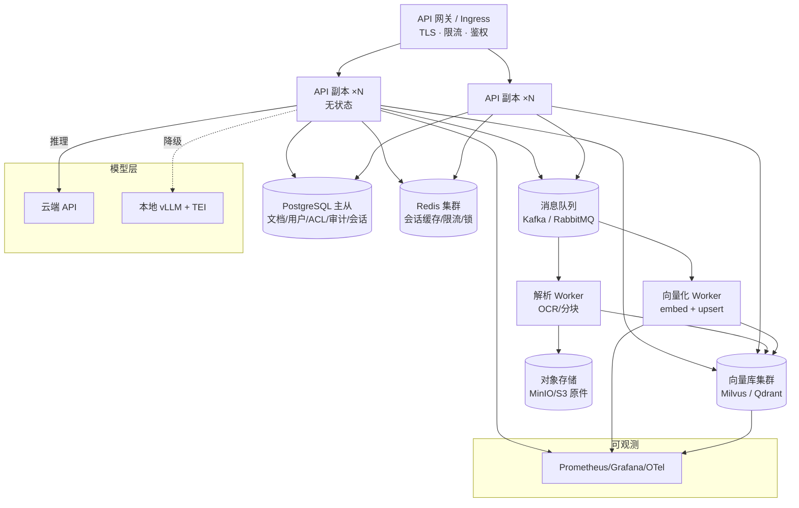

# 方案：分布式与高可用架构（P2-⑧，仅方案不实施）

> 对应《企业级升级方案 v3.0》P2-⑧。
> **本文档是设计/规划文档，不包含实现代码**——本机没有 K8s 集群、没有云资源，
> 写代码也无法验证，不如把"该怎么做、做到什么标准、什么时候才需要做"讲清楚。

---

## 1. 现状与瓶颈（先量化，再决定要不要分布式）

### 1.1 当前单机架构

| 组件 | 现状 | 天花板 |
| --- | --- | --- |
| 向量索引 | FAISS `IndexFlatIP` 进程内存 | 内存即上限；重建需全量 O(N) |
| 稀疏检索 | rank-bm25 + jieba，进程内 | 全量打分 O(N)，单进程 |
| 元数据 | SQLite（WAL） | 单写锁；无主从 |
| 应用 | FastAPI 单进程 | 无副本，进程挂即全站挂 |
| 异步任务 | `TaskRunner` 线程池（进程内） | 进程重启任务丢失（已做中断标记） |

### 1.2 关键容量公式（用来算"什么时候撑不住"）

```
向量内存（FAISS flat, float32）  ≈ N_chunks × D × 4B
HNSW 额外开销                    ≈ ×1.3
向量磁盘（快照/备份）            ≈ 同内存量 × 副本数

例：bge-m3 维度 D=1024
  10 万 chunk   ≈ 0.4 GB 内存
  100 万 chunk  ≈ 4 GB
  1000 万 chunk ≈ 40 GB（单机可取，但已接近单节点上限）
```

**单机可行的经验阈值**（触达即应考虑分布式）：
- 索引内存 > 单机内存 60%
- 检索 P95 > 1s（含改写/重排可再放宽）
- 单机 CPU 持续 > 70% 无法再压
- 文档数 > 50 万 / chunk > 500 万
- 需要多副本 SLA（99.9%）或租户级隔离

> 本项目当前规模：6 份文档 / 47 分块（评测语料），检索 P95 < 300ms——**远未触达**，
> 这也是为什么"分布式"当前只是方案而非实施项。

---

## 2. 目标架构



### 2.1 关键变更点（相对当前）

| 项 | 现在 | 目标 |
| --- | --- | --- |
| 应用 | 单进程 | 无状态多副本 + 负载均衡 |
| 元数据 | SQLite | PostgreSQL 主从（Patroni 或云 RDS） |
| 向量库 | FAISS 内存 | Milvus / Qdrant / pgvector（按规模） |
| 稀疏检索 | 进程内 BM25 | Elasticsearch 或 Milvus 稀疏向量 |
| 异步任务 | 线程池 | Kafka/RabbitMQ + 独立 Worker（`TaskRunner` 接口已预留） |
| 编排 | 手工启动 | K8s Deployment + HPA + 探针 |

---

## 3. 选型对比

| 维度 | **pgvector** | **Qdrant** | **Milvus 分布式** |
| --- | --- | --- | --- |
| 适用规模 | < 500 万 chunk | 500 万 – 5000 万 | > 5000 万 |
| 运维复杂度 | 最低（与业务库同源） | 低-中（单二进制/集群） | 高（etcd/MinIO/Pulsar 依赖多） |
| 元数据过滤 | SQL `WHERE`（原生） | payload filter（强） | expr filter + partition key |
| 权限过滤下推 | `WHERE doc_id = ANY(...)` 或 RLS | filter 表达式 | filter 表达式 / 分区 |
| 多副本 | PG 流复制（读副本） | 副本因子可配 | 副本（replica）+ 分片 |
| 混合检索（稀疏） | 需自建（BM25 另存） | 支持 sparse vectors | 2.4+ 支持稀疏向量 |
| 水平扩展 | 垂直为主 | 分片（shard） | 原生分片 |
| 迁移成本 | 最低（已有 `VectorStore` 适配点） | 中 | 高 |

**分阶段决策**（不要一步到位）：

```
≤ 500 万 chunk  →  pgvector（与 PostgreSQL 同源，权限过滤用 SQL 下推）
500 万 – 5000 万 → Qdrant（HNSW + payload filter + 分片/副本）
> 5000 万 chunk  → Milvus 分布式（分片 + 多副本 + 冷热分层）
```

> 当前代码中 `AdvancedRAG` 的检索方法已把"取候选 → 融合 → 重排"拆开，
> 迁移时只需替换「向量检索实现」这一处（新增 `VectorStore` 适配器），检索管线与权限过滤逻辑不变。

---

## 4. 索引与分片设计要点

1. **分片键**：`tenant_id` + `doc_id` 哈希 → 同文档的分块落在同一分片（删除/重建局部化）；
2. **分区**：按租户/密级做 partition key，过滤条件下推到存储层（避免"先取 1000 再过滤"）；
3. **索引参数**：
   - HNSW：`M=32`、`efConstruction=200`、查询 `ef=64`（召回与延迟平衡的常用起点，需压测调优）；
   - 超大集合可用 IVF-PQ 降低成本（精度换内存）；
4. **BM25 位置**：
   - 小规模：保留独立 BM25 服务（内存索引 + 副本）；
   - 大规模：Elasticsearch（原生 BM25 + 分布式）或 Milvus 稀疏向量（一栈到底）；
5. **元数据分离**：PostgreSQL 存 doc/chunk 元数据与版本，向量库只存 `id + vector + 少量过滤字段`
   （避免把业务数据塞进向量库导致同步困难）。

---

## 5. 高可用与一致性

### 5.1 写入流程（幂等 + 可回滚）

```
上传 → 对象存储(原件) → MQ → 解析 Worker（OCR/分块）→ 向量化 Worker
     → 写入新版本集合（或同集合 + version 字段）→ 校验通过 → 别名/指针切换
```

- **幂等键**：`chunk_id = doc_id:version:index`，重复写入幂等；
- **冻结切换**：新版本写完后原子切换读别名，失败可回滚到上一版本；
- **软删除**：逻辑删除 + 后台清理任务（保留 30 天可恢复）。

### 5.2 副本与故障

| 故障 | 处理 |
| --- | --- |
| API 副本挂 | LB 摘除，HPA/探针自动重启 |
| 向量库分片副本挂 | 副本自动接管（Qdrant/Milvus 副本机制） |
| PostgreSQL 主库挂 | Patroni 自动 failover（秒级） |
| 向量库整体不可用 | **降级**：退化为「BM25 only」或「无检索直答 + 提示」 |
| 模型 API 不可用 | 降级本地模型（P1-⑤ 路由层）或返回缓存 |

### 5.3 备份与演练

- 向量库：快照（每日）+ 保留 7 天；
- PostgreSQL：WAL 归档 + PITR（保留 30 天）；
- 对象存储：版本化 + 跨区复制；
- **季度恢复演练**（未演练的备份等于没有备份）。

---

## 6. 容量模型（用于采购/扩容决策）

| 变量 | 取值 | 说明 |
| --- | --- | --- |
| chunk 数 N | 1000 万 | 典型企业 20 万文档 × 50 块 |
| 维度 D | 1024 | bge-m3 |
| 向量内存 | N×D×4×1.3 ≈ **53 GB** | HNSW 索引常驻 |
| 副本数 | 3 | 读扩展 + 高可用 |
| 集群内存需求 | ≈ **160 GB** | 4 台 64GB 节点（留 30% 余量） |
| 检索 QPS | 目标 100 | 需压测确认单节点承载 |
| 写入吞吐 | 20 doc/s 峰值 | 由解析 Worker 数控制 |

> 结论：**模型与索引分离**（向量库只吃向量，模型走推理服务）是扩容的前提；
> 千万级规模的总成本大头是内存/GPU，而不是代码。

---

## 7. 压测计划（方案，不写脚本）

| 项 | 内容 |
| --- | --- |
| 工具 | k6（HTTP 压测）/ Locust（Python 场景）/ Milvus 官方 benchmark |
| 场景 1 | 检索阶梯：10 / 50 / 100 / 200 QPS，1 分钟一档 |
| 场景 2 | 问答端到端：10 / 30 / 50 QPS（含改写 + 重排，计入模型延迟） |
| 场景 3 | 并发上传：100 文档同时上传（验证 MQ 削峰、任务不丢） |
| 场景 4 | 长稳：30% 负载跑 2 小时（查内存泄漏/连接池耗尽） |
| 指标 | P50/P95/P99、错误率、CPU/内存、队列积压、召回耗时、rerank 耗时 |
| 验收 | 100 QPS 下成功率 ≥ 99.9%，P99 < 1s（检索层）；端到端 P95 < 5s |
| 输出 | `docs/perf_report.md`（含瓶颈定位与扩容建议） |

---

## 8. 迁移路径（从当前单机到分布式）

| 阶段 | 动作 | 回滚点 | 验收 |
| --- | --- | --- | --- |
| **P1** | SQLite → PostgreSQL（元数据/会话/审计） | 保留 SQLite 文件 | 全量测试通过 + 数据一致 |
| **P2** | FAISS → pgvector（≤500 万 chunk） | 保留 FAISS 适配器 | 检索指标不回归（用质量门禁） |
| **P3** | 线程池任务 → MQ + 独立 Worker | 保留进程内 Runner | 任务不丢、可重试 |
| **P4** | API 多副本 + K8s + HPA + Prometheus | 单副本可回退 | 压测达标 |
| **P5** | pgvector → Milvus/Qdrant（超规模） | 双写过渡期 | 指标一致 + 成本评估 |

> 每一阶段都必须通过**质量门禁**（`scripts/check_metrics.py`）与**全量测试**，否则不进入下一阶段——
> 这是分布式迁移里最容易出事的地方：换了存储，指标悄悄下降。

---

## 9. 风险与取舍

| 风险 | 说明 | 缓解 |
| --- | --- | --- |
| 复杂度爆炸 | 从 1 进程变成 8 个服务 | 分阶段；小规模客户用单机版（compose） |
| 成本失控 | 内存/GPU 是大头 | 按需扩容 + 冷热分层 + 语义缓存 |
| 一致性难题 | 元数据与向量库双写 | 幂等键 + 版本切换 + 对账任务 |
| 迁移回归 | 换存储后指标下降 | 质量门禁强制把关 |
| 运维压力 | 需要 SRE 能力 | 托管服务（云 RDS/Milvus 云）优先 |

---

## 10. 结论：什么时候真的要做

**当前不做**：6 文档 / 47 分块，单机 P95 < 300ms，没有多副本 SLA 需求。

**触发条件（满足任意 2 条再启动）**：
1. chunk > 500 万或索引内存 > 单机 60%；
2. 检索 P95 > 1s 且优化无效；
3. 需要 99.9% SLA 或多租户物理隔离；
4. 并发上传导致任务积压（单机线程池打满）。

**最小可行路径**：先做 P1（PostgreSQL）与 P2（pgvector）——这两步成本最低、
对当前代码改动最小（`VectorStore` 适配器 + 仓储层），且能直接复用现有权限过滤与评测体系。
真正的 Milvus 分布式留到规模触发时再做。
