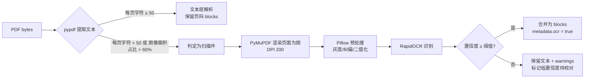
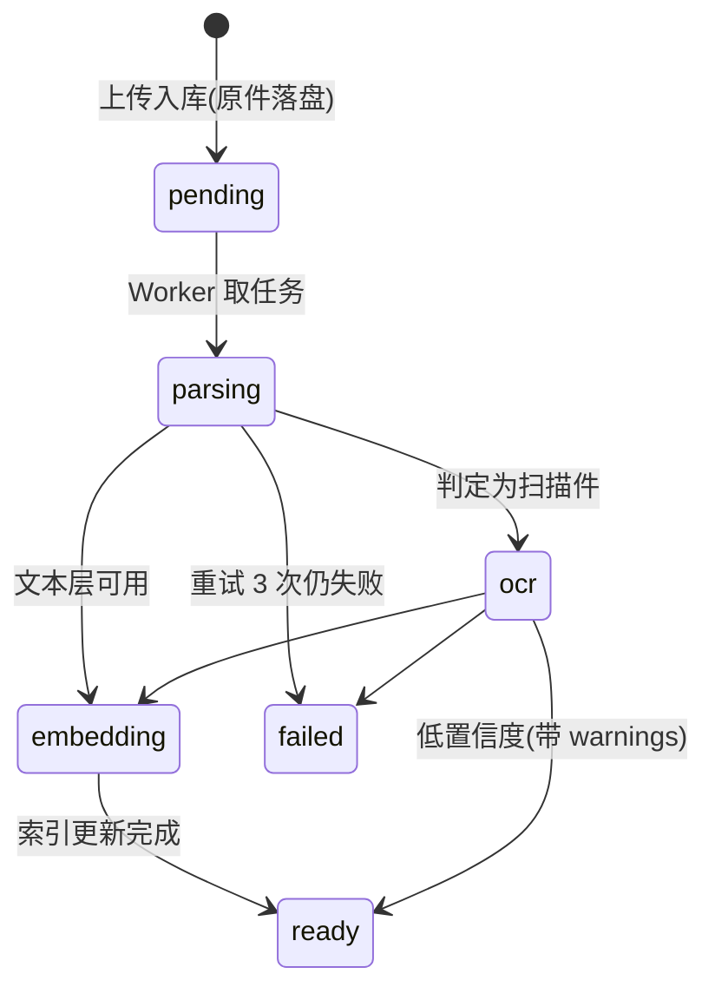

# 设计文档：文档解析子系统升级（P0-①）

> 对应《企业级升级方案 v3.0》问题 1：不支持 .docx / Excel / 扫描件 PDF（无 OCR）。
> 本文档在动手前确定：**做什么、改在哪一层、为什么这么改、技术选型的原理与优势、如何验收**。

---

## 1. 范围界定

### ✅ 本期做（In Scope）
1. **解析器插件化**：`app/parsers/` 子系统，格式能力与业务流程解耦；
2. **多格式支持**：`.pdf`（文本层 + 扫描件 OCR）、`.docx`、`.xlsx/.xls`、`.pptx`、`.csv`、`.html/.htm`、`.json`、`.txt/.md`、图片（`.png/.jpg/.jpeg/.bmp/.tiff`）；
3. **统一解析契约**：`ParsedDocument` + `Block`（标题/段落/表格/图片），让下游不再感知格式差异；
4. **结构感知分块**：按标题层级切分 + 表格语义化 + 块内注入「文档名 > 章节路径」上下文；
5. **异步任务化**：上传返回 `task_id`，解析/OCR/向量化后台执行，进度可查；小文件走同步快路径；
6. **解析缓存**：按内容 MD5 缓存解析结果，重复上传零成本；原件留存便于重放与审计；
7. **测试与量化**：新增解析单元测试 + 扩充评测语料（含 docx/xlsx），用现有评测体系证明「结构感知分块」的收益。

### 🚫 本期不做（Out of Scope，留待后续）
- `.doc` 老格式：需外部 LibreOffice，**仅做检测与友好提示**（检测到 `soffice` 才启用）；
- 坐标级版面还原（PP-StructureV3 级别）、手写体 OCR；
- 向量库迁移 / 权限过滤（属 P0-③）；MQ 分布式 Worker（属 P1，本期预留接口）。

---

## 2. 改在哪一层（分层视角）⭐

这是本次升级最需要说清楚的部分——**它不是"加几个 if-else 判断扩展名"，而是在四个层面做结构性改造**：

| 层面 | 现状 | 改造后 | 价值 |
| --- | --- | --- | --- |
| **① 抽象层**（新增） | 无，解析逻辑写在业务服务里 | 新增 `app/parsers/` 子系统：`BaseParser` 契约 + `Registry` 注册表 + 各格式实现 | 新增格式**只加一个类**，核心业务零改动（开闭原则） |
| **② 契约层**（新增数据模型） | `parse_file()` 只返回 `str`，标题/表格信息在上游即丢失 | 统一 `ParsedDocument{text, blocks[], metadata, warnings}` | 下游（分块/索引/检索）**不感知格式差异**，避免分支爆炸 |
| **③ 流水线层**（同步→异步） | 上传接口内同步解析+向量化，大文件/OCR 必然超时 | 任务状态机 + 后台执行 + 进度查询 + 结果缓存 | OCR 单文档 10–60s 也能安全处理，接口 P95 < 500ms |
| **④ 检索层**（增强） | 定长滑窗切分，语义被拦腰截断，无上下文 | 结构感知分块 + 表格语义化 + 章节路径前缀 | 直接提升召回命中与引用可解释性（**可用评测集量化**） |

### 代码级问题定位（改造锚点）

| 位置 | 现状 | 问题 |
| --- | --- | --- |
| `app/document_processor.py:36-45` | `parse_file()` 内 `if .pdf … else utf-8` | 格式耦合在核心服务；非 UTF-8 以外的格式直接当文本解码，产生乱码或空内容 |
| `app/routes.py:26,39` | `ALLOWED_EXTENSIONS = {".pdf", ".txt", ".md"}` 硬编码 | 白名单与真实解析能力脱节，两处维护易不一致 |
| `app/chunking.py` | 纯字符滑窗 / 段落聚合 | 不知道标题与表格存在，切分点与语义边界无关 |
| `app/routes.py:44-60` | 上传接口内同步 `add_document()` + 重建索引 | 大文件/OCR 阻塞请求，且一次上传触发全量重建 |

---

## 3. 技术选型：原理、优势与取舍

| 需求 | 选型 | 原理/优势 | 为什么不用替代方案 |
| --- | --- | --- | --- |
| `.docx` 解析 | **python-docx** | 直接读取 OOXML：段落样式（Heading 1–6）→ 标题层级、`tables` → 表格对象 | `mammoth` 转 HTML 会丢层级语义；`docx2txt` 丢表格结构；`unstructured` 依赖重（含 torch 生态） |
| `.xlsx` 解析 | **openpyxl**（`read_only` 模式） | 保留 sheet 名、合并单元格、公式位置；流式读取内存友好 | `pandas.read_excel` 丢 sheet 结构且大表吃内存；`xlrd` 已不支持 xlsx |
| `.pptx` 解析 | **python-pptx** | 可读幻灯片标题/正文**以及备注页**（备注常含关键结论） | 直接解 XML 易错且无收益 |
| PDF 文本层 | **pypdf**（现有） | 纯 Python、无外部依赖、已集成 | 不换，避免无谓回归风险 |
| PDF 渲染成图（给 OCR） | **PyMuPDF (fitz)** | **纯 wheel，自带渲染引擎，无需 poppler 等外部二进制** | `pdf2image` 依赖 poppler——Windows 上要额外装二进制，部署/交付极其麻烦；`pdfplumber` 不能渲染 |
| OCR 引擎 | **RapidOCR (onnxruntime)** | 模型内置、纯 pip 安装、CPU 可跑、无网络依赖；单页中文 ~1–3s | PaddleOCR 精度略高但依赖 paddle（Windows 安装易踩坑、体积大）；云 OCR 数据出网 + 按量计费，与「数据不出内网」目标冲突 |
| 图像预处理 | **Pillow**（已装） | 灰度/二值化/纠偏可显著提升 OCR 命中率 | — |
| HTML 解析 | **beautifulsoup4** | 保留标题层级与列表结构，去标签干净 | 正则去标签会破坏结构 |
| 表格语义化 | **自研规则**（不引库） | 规则简单可控、输出 token 可预算；避免引入大依赖 | `unstructured` 的表格摘要需要额外模型调用，成本高且不可控 |

**新增依赖体积提示**：`python-pptx`（~1MB）、`PyMuPDF`（~20MB）、`rapidocr-onnxruntime` + `onnxruntime`（已有，模型 ~15MB）。均不影响现有功能，且**全部离线可用**。

---

## 4. 关键设计

### 4.1 解析器契约与注册表

```python
# app/parsers/base.py
@dataclass
class Block:
    type: Literal["title", "paragraph", "table", "image"]
    text: str
    level: int = 0          # 标题层级（title 有效）
    page: int | None = None # PDF 页码
    sheet: str | None = None# Excel sheet 名
    meta: dict = field(default_factory=dict)

@dataclass
class ParsedDocument:
    text: str               # 全文（供无结构场景/兜底）
    blocks: list[Block]     # 结构块（供结构感知分块）
    metadata: dict          # 页数/作者/sheet 列表/是否 OCR 等
    warnings: list[str]     # 解析告警（低置信度、跳过内容等）

class BaseParser(Protocol):
    extensions: tuple[str, ...]
    name: str
    def supports(self, ext: str) -> bool: ...
    def parse(self, content: bytes, filename: str) -> ParsedDocument: ...
```

```python
# app/parsers/__init__.py  —— 注册表 + 唯一入口
PARSERS: list[BaseParser] = [PdfParser(), DocxParser(), ExcelParser(), PptxParser(),
                             CsvParser(), HtmlParser(), JsonParser(), TextParser(), ImageParser()]

def get_parser(filename: str) -> BaseParser: ...
def supported_extensions() -> set[str]: ...      # 供 routes 白名单动态生成，消除双份维护
def parse_document(content: bytes, filename: str) -> ParsedDocument: ...
```

**原理**：注册表模式（Registry）把「格式 → 处理逻辑」的映射从 `if-else` 变成**数据驱动的集合查找**。新增格式 = 新增一个类 + 入表，符合开闭原则；白名单由 `supported_extensions()` 动态产出，`routes.py` 不再硬编码。

### 4.2 扫描件判定与 OCR 流水线



判定阈值（可配置，写入 config）：`SCANNED_TEXT_PER_PAGE_MIN=50`、`SCANNED_IMAGE_RATIO_MAX=0.6`、`OCR_DPI=200`、`OCR_MIN_CONFIDENCE=0.6`。

**为什么先判定再 OCR**：OCR 成本是文本层解析的 100 倍以上（CPU 1–3s/页 vs 毫秒级）。先判定可避免「对已是文本的 PDF 做无谓 OCR」，这是典型的**成本-精度权衡**。

### 4.3 表格语义化（提升结构化问答命中率）

纯 Markdown 表格在向量检索里表现差——行列值被拆散、缺少主语，嵌入语义不完整：

```
原始：| 城市级别 | 住宿标准 |
      | 一线城市 | 500 元/晚 |

仅 Markdown 入库 → 问「出差住宿能报多少」很难命中
```

**双写策略**（同时保留两种表示，互为补充）：

| 表示 | 内容 | 作用 |
| --- | --- | --- |
| 结构化文本 | Markdown 表格（保留在 `blocks[].text`） | 人工阅读、答案展示 |
| 语义化语句 | 逐行展开 + 表头补全：`差旅住宿标准：一线城市 住宿标准 500 元/晚。` | 向量召回、BM25 关键词命中 |

实现要点：取表头行 → 对每行生成「表名/章节 + 列名=值」的自然语言句；合并单元格向下填充；超宽表（列 > 15 或行 > 300）截断并写 `warnings`。

### 4.4 结构感知分块（本次对检索质量影响最大的一环）

**现状问题**：`split_text_recursive` 只按段落和长度聚合，切出的块**没有上下文**——「年假增加至10天」这一块不知道自己属于《员工手册》的「第三章 休假制度」。

**改造**：分块时携带结构路径，并在块内注入轻量前缀：

```
[员工手册.md > 第三章 休假制度]
员工入职满一年后，每年享有5天带薪年假；工作满三年后，年假增加至10天。
```

**原理与收益**：
1. **语义完整性**：embedding 时块自带主题上下文，缓解「分块后语义孤岛」问题；
2. **BM25 交叉命中**：问题里出现「休假制度」也能命中该块（原文本块内并无此词）；
3. **引用可解释**：答案来源能显示章节路径，企业场景里比「员工手册.md」更有说服力；
4. **边界更合理**：优先在标题处切分，避免一句话被拦腰截断。

**代价与开关**：前缀约占 10–20 字/块（首尾有 token 成本）；通过 `CHUNK_CONTEXT_HEADER=true/false` 配置，评测脚本可对比开/关两种模式的指标，用数据决定默认值。

### 4.5 异步任务化、状态机与缓存



- **同步快路径**：文件 < 200KB 且非扫描件 → 同步完成（保持前端体验与向后兼容），否则返回 `task_id` 异步处理；
- **幂等**：`chunk_id = f"{doc_id}_{chunk_index}"`，重复向量化 upsert 不产生脏数据；
- **缓存**：解析结果按 `md5(原文件)` 缓存为 `data/parsed/{md5}.json`，原件存 `data/uploads/{md5}{ext}`；
- **可替换性**：任务执行器抽象为 `TaskRunner`（本期 `InProcessRunner`，P1 换成 `MQRunner` 时业务代码不改）。

### 4.6 API 变更（向后兼容）

| 接口 | 变化 |
| --- | --- |
| `POST /documents/upload` | 返回值新增 `task_id` / `status`（`ready` 或 `processing`）；同步路径行为与现在一致 |
| `GET /documents/tasks/{task_id}` | **新增**：查询解析进度与告警 |
| `GET /documents` | 返回值新增 `status`、`format`、`pages`、`blocks` 等展示字段 |
| `GET /health` | 新增 `parsers`（已注册格式清单）与 `ocr_available` |

---

## 5. 能解决什么问题（对照）

| 原问题 | 具体表现 | 本方案解法 |
| --- | --- | --- |
| 不支持 Office 文档 | 企业 80%+ 知识资产是 Word/Excel/PPT，无法入库 | `python-docx`/`openpyxl`/`python-pptx` 解析为统一结构块 |
| 扫描件 PDF 无用 | 文本层为空 → 被当成「空文档」直接报错丢弃 | 扫描件判定 + PyMuPDF 渲染 + RapidOCR 识别 |
| 表格信息丢失 | 行列数据被拍平成无序文本，问答答不准 | 表格语义化双写（Markdown + 自然语言句） |
| 大文件上传超时 | 同步解析+向量化阻塞请求，易 502 | 异步任务化 + 状态查询 + 缓存 |
| 分块无上下文 | 语义孤岛，召回与引用可解释性差 | 结构感知分块 + 章节路径前缀 |
| 白名单双份维护 | 路由硬编码与解析能力脱节 | `supported_extensions()` 动态生成 |

---

## 6. 如何证明有效（验收标准 DoD）

1. **功能**：9 类扩展名（pdf/docx/xlsx/pptx/csv/html/json/txt+md/图片）均可上传并成功入库；扫描件 PDF 能识别出文本；
2. **质量**：新增 `tests/test_parsers.py`——每种格式用代码生成最小样本，断言「标题层级、表格语义化、扫描件判定、告警」行为；全部离线（OCR 用小图或打桩），`pytest` 全绿；
3. **性能**：> 200KB 文件上传接口 P95 < 500ms（异步）；重复上传命中缓存，二次解析耗时 ≈ 0；
4. **效果（量化）**：评测语料加入 `.docx` 与 `.xlsx` 样本，跑 `python scripts/eval_rag.py`，对比「旧定长分块 vs 结构感知分块」的 Hit@3 / MRR@5，**给出实测数字**并写入 `docs/eval_report.md`；
5. **兼容**：既有 `.txt/.md/.pdf` 文档与现有 2 份已入库文档不受影响；服务可正常启动、前端上传交互可用。

---

## 7. 风险与缓解

| 风险 | 缓解 |
| --- | --- |
| OCR 引入体积与冷启动变慢 | 惰性加载（首次 OCR 才导入模型）；`OCR_ENABLED=false` 可关闭 |
| Excel 超大表导致 token 膨胀 | 行列上限 + 分 sheet 分块 + 超限写 warnings |
| 结构感知分块改变索引结构 | 提供开关；用评测对比后再定默认值；上传后自动重建索引 |
| 异步任务在单进程挂掉丢状态 | 状态落 SQLite，启动时把 `parsing/embedding` 中的任务标记为 `failed` 并提供重试接口 |
| `.doc` 等老格式 | 检测 LibreOffice，缺失时返回明确指引而非静默失败 |

---

## 8. 待确认的决策点

| # | 决策 | 备选 | 建议 |
| --- | --- | --- | --- |
| D1 | OCR 引擎 | RapidOCR / PaddleOCR / 云 OCR / 暂不做 | **RapidOCR**（离线、CPU、零外部依赖） |
| D2 | 本期格式范围 | 推荐组合（Office+PDF+图片+文本）/ 仅 Office 三件套 / 追加 `.doc`（需装 LibreOffice） | **推荐组合** |
| D3 | 异步实现 | 进程内后台任务 + 状态查询 / 直接上 Redis+RQ / 保持同步 | **进程内后台任务**（零外部依赖，接口预留 MQ） |
| D4 | 分块默认策略 | 升级为结构感知（需重建索引）/ 保持定长滑窗 | **升级**，用评测数据把关 |

---

*确认后即按本设计实施，顺序：解析契约与注册表 → 各格式解析器 → 扫描件判定与 OCR → 结构感知分块 → 异步任务与缓存 → 测试 → 评测对比 → 文档更新。*

---

## 9. 实施结果（已完成 ✅）

决策：D1 RapidOCR ｜ D2 推荐组合格式 ｜ D3 进程内后台任务 ｜ D4 升级结构感知分块。

### 9.1 交付物

| 层面 | 产物 |
| --- | --- |
| 抽象层 | `app/parsers/`：`base.py`（契约 + 表格语义化）、`__init__.py`（注册表 + 缓存）、9 个解析器、`ocr.py`（惰性 RapidOCR） |
| 契约层 | `ParsedDocument` / `Block` / `ParseError`；统一 19 种扩展名 |
| 流水线层 | `app/tasks.py`（TaskRunner 状态机）、`routes.py` 同步/异步分流、`GET /documents/tasks/{id}`、`db.py` 任务表 + 老库自动迁移 |
| 检索层 | `app/chunking.py::split_blocks`（标题层级 + 表格语义化 + 章节路径前缀） |
| 工具 | `scripts/make_samples.py`（生成多格式样例）、`scripts/inspect_chunks.py`（查看解析结果）、`scripts/eval_chunking.py`（A/B 评测） |
| 文档 | README 更新、`.env.example` 新增解析/OCR/异步配置、`requirements.txt` 新增 7 个依赖 |

### 9.2 单元测试

`pytest`：**61 项全部通过**（升级前 30 项），新增覆盖：
- 注册表与格式分发、不支持格式报错；
- Word 标题层级与表格、Excel sheet 与语义化、PPT 备注页、Markdown 标题、GBK 回退、JSON 展平、CSV/HTML 表格；
- 扫描件判定（构造无文本层 PDF）+ OCR 路径（打桩，离线）；
- 解析缓存命中、表格截断告警；
- 结构感知分块（章节路径、前缀开关、嵌套章节、表格独占、超长切分）；
- API：多格式上传、损坏文件返回 400（非 502）、异步任务全流程轮询、健康检查暴露解析器能力。

### 9.3 端到端验证（真实文件）

| 样本 | 结果 |
| --- | --- |
| `samples/员工手册.docx` | 同步就绪，6 个结构块 → 2 块，块带 `[员工手册.docx > 第三章 休假制度]` 前缀 |
| `samples/库存台账.xlsx` | 同步就绪，2 个 sheet → 3 块，逐行语义化（"库存数量 为 120"） |
| `samples/产品介绍.pptx` | 同步就绪，**备注页内容被检索命中**（问"关键结论"答出"营收环比增长20%"） |
| `samples/扫描件示例.pdf`（4MB，无文本层） | 异步任务 `ocr → ready` 约 8 秒，OCR 准确识别中文并可检索 |
| 问答引用 | 答案来源精确到章节：`（来源：员工手册.md > 第三章 休假制度）` |
| 老库迁移 | v2.0 数据库自动补齐新列，老文档照常加载；重新入库后 2 块 → 6 块（结构生效） |

### 9.4 分块策略 A/B 量化结果

| 方案 | 分块数 | Hit@3 | Hit@5 | MRR@5 |
| --- | ---: | ---: | ---: | ---: |
| A 旧：纯文本滑窗 | 19 | 91.7% | 95.8% | 84.2% |
| B 新：结构感知 + 章节前缀 | 47 | 91.7% | **100.0%** | **91.5%** |

**收益：Hit@5 +4.2pp、MRR@5 +7.3pp**（真实 API 运行，`python scripts/eval_chunking.py` 可复现）。

### 9.5 仍待办（下一项 P1）

- `.doc` 老格式（需 LibreOffice）——当前仅检测提示；
- 坐标级版面还原（PP-StructureV3 级别表格结构重建）；
- 异步任务替换为 MQ + 独立 Worker（接口已预留：`TaskRunner` 可替换）；
- 低置信度 OCR 结果的人工校对队列（当前仅写告警）。
