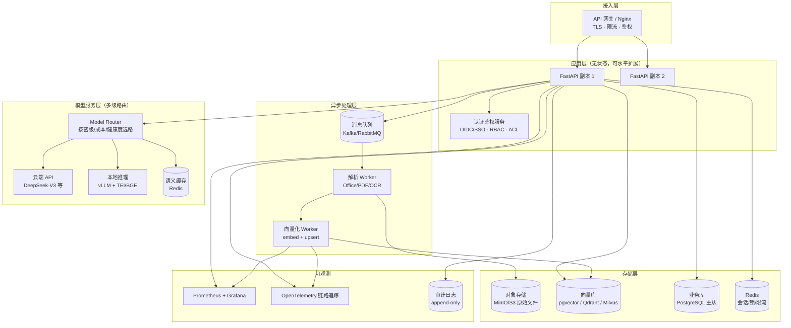

# 企业级升级方案（v3.0 规划）

> 目标：把当前的「单机 Agentic RAG 演示系统」升级为「可交付、可审计、可扩展的企业知识中台」。
> 本文档针对 5 个已知短板给出企业级解法、技术选型、量化收益与实施路线图。

---

## 0. 现状 vs 目标架构

### 现状（v2.0）
```
单进程 FastAPI
 ├── 解析：pdf/txt/md（同步，阻塞请求）
 ├── 索引：FAISS + BM25（进程内存，重启重建）
 ├── 存储：SQLite（单机文件）
 ├── 模型：硅基流动云端 API（强依赖外网）
 ├── 会话：MemorySaver（进程内存）
 └── 安全：无认证、无权限、无审计
```

### 目标架构（v3.0）


---

## 1️⃣ 支持 .docx / Excel / 扫描件 PDF（含 OCR）

### 方案：解析器插件化 + 结构感知 + 异步 OCR 流水线

**1.1 解析器抽象（Registry 模式）**
```python
# app/parsers/base.py
@dataclass
class ParsedDocument:
    text: str                     # 全文（供分块/检索）
    blocks: list[Block]           # 结构块：title/paragraph/table/image
    metadata: dict                # 页数、sheet 名、作者、创建时间

class BaseParser(Protocol):
    extensions: tuple[str, ...]
    def parse(self, content: bytes, filename: str) -> ParsedDocument: ...

# app/parsers/__init__.py
PARSER_REGISTRY = {".pdf": PdfParser, ".docx": DocxParser, ".xlsx": ExcelParser, ...}
```
统一「结构块」中间表示，让后续分块能按标题层级切（而不是按 300 字符硬切）。

**1.2 各格式实现**

| 格式 | 库 | 关键处理 |
| --- | --- | --- |
| `.docx` | `python-docx` | 标题样式（Heading 1-6）→ 结构块；表格转 Markdown；批注/页眉可选 |
| `.doc`（老格式） | LibreOffice headless 转换 | `soffice --convert-to docx`，转换失败进死信队列 |
| `.xlsx/.xls` | `openpyxl` + `pandas` | 每个 sheet 单独成块；合并单元格展开；**表格语义化** |
| `.pptx` | `python-pptx` | 幻灯片标题 + 正文 + 备注（备注常含关键信息） |
| `.csv/.html/.json/.md` | 内置 | HTML 去标签保留标题层级 |
| 扫描件 `.pdf` / 图片 | **OCR 引擎** | 见 1.3 |

**表格语义化**（企业问答的关键，纯 Markdown 表格召回差）：
```
原始表格行：| 产品A | 库存 120 | 单价 35 元 |
语义化输出（同时入库，提高命中）：
  「产品A 的库存为 120，单价为 35 元。」
```

**1.3 扫描件 PDF 判定与 OCR**
```python
def is_scanned(pdf) -> bool:
    text_per_page = len(extract_text()) / max(pages, 1)
    image_ratio = 图像覆盖面积 / 页面面积
    return text_per_page < 50 or image_ratio > 0.6
```
- OCR 引擎选型：

| 引擎 | 优势 | 代价 | 适用 |
| --- | --- | --- | --- |
| **RapidOCR**（ONNX） | 轻量、CPU 可跑、部署简单、中文尚可 | 精度中等 | ✅ 首选，容器内直接跑 |
| PaddleOCR / PP-StructureV3 | 精度高、版面还原（表格/标题）强 | 依赖重、需 GPU 更快 | 高质量要求场景 |
| 云 OCR（百度/腾讯/阿里） | 零运维、精度高 | 数据出网、按量计费 | 非敏感文档 |

- 版面还原：PP-StructureV3 输出「标题/段落/表格」结构，直接映射为 `blocks`
- 图片内嵌 OCR：docx/pptx 中的图片可选走 OCR 补全

**1.4 工程要求**
- **异步化**：解析 + 向量化放进消息队列（Kafka/RabbitMQ + Worker），上传接口立即返回 `task_id`，前端轮询/SSE 看进度 → 解决大文件超时、502
- **解析缓存**：按文件 MD5 缓存 `parsed.json`，同一文件重复上传零成本
- **失败可观测**：重试 3 次 → 死信队列；每份文档记录解析状态机（pending/parsing/ocr/embedding/ready/failed）
- **增量索引**：文档更新只重建该文档的分块（按 `doc_id` 删除再插入）

### 收益
- **企业价值**：覆盖企业真实知识资产（Word/Excel/PPT/扫描件占绝大多数），系统从「演示」变「能用」
- **量化**：支持格式 3 种 → 15+ 种；扫描件从不可用到可检索；上传大文件不再 502；重复上传成本降为 0
- **简历说法**：「设计插件化文档解析体系，支持 15+ 格式与 OCR 版面还原，解析异步化避免请求阻塞」

---

## 2️⃣ 摆脱对云端 API 的强依赖（离线可用 + 多级路由）

### 方案：Provider 抽象 + 多级路由 + 本地推理 + 语义缓存

**2.1 统一 Provider 接口**
```python
class ModelProvider(Protocol):
    def chat(self, messages, **kw) -> str: ...
    def embed(self, texts: list[str]) -> list[list[float]]: ...
    def rerank(self, query, docs, top_n) -> list[dict]: ...

providers = {
    "cloud":  SiliconFlowProvider(),   # 现有
    "local":  VLLMProvider(),          # vLLM / TEI
    "ollama": OllamaProvider(),        # 轻量本地（开发/演示）
}
```

**2.2 本地推理栈（离线模式）**

| 组件 | 推荐 | 说明 |
| --- | --- | --- |
| 对话 LLM | vLLM + `Qwen2.5-14B-Instruct-AWQ` | 单卡 4090/A10 可跑；32B 需 2 卡或 A100 |
| Embedding | `BAAI/bge-m3` + **TEI** 或 sentence-transformers | CPU 可跑，批处理吞吐高 |
| Reranker | `bge-reranker-v2-m3` + TEI | CPU 可用，延迟 ~50ms |

> 与线上一致：embedding/rerank 用同一套开源权重，**离线与云端检索结果可比**，评测口径不变。

**2.3 路由与降级策略**

| 决策维度 | 规则 |
| --- | --- |
| 数据密级 | `机密/绝密` → **强制本地**，禁止出网（网关层强制，不依赖业务代码自觉） |
| 任务难度 | 简单问答/改写 → 本地小模型；复杂推理 → 云端大模型 |
| 可用性 | 云端超时/429/5xx → 自动切本地（熔断 + 半开重试），记录降级指标 |
| 成本 | 命中语义缓存直接返回；低价值请求走本地 |
| 灰度 | 按流量比例 A/B，对比质量与成本 |

**2.4 语义缓存**
```
query → embedding → 在缓存中做相似度检索
  ├── 相似度 ≥ 0.95 → 直接返回缓存答案（耗时从 3s → 50ms）
  └── 未命中 → 走完整管线，结果写缓存（TTL 7 天）
文档更新时按 doc_id 精确失效相关缓存
```

### 收益
- **企业价值**：数据不出内网，满足等保/行业合规；断网、限流、API 故障时服务不中断
- **量化**：离线可用性 0 → 100%；云端故障时服务可用性保持 100%（降级）；语义缓存可降低 30-60% token 成本、P95 延迟降 50%+
- **简历说法**：「实现多后端模型路由（云端/本地 vLLM+TEI），支持按数据密级强制本地推理与自动降级，语义缓存降低 30%+ 调用成本」

---

## 3️⃣ 多用户体系与权限隔离（含检索期权限过滤）

### 方案：SSO 认证 + RBAC/ACL 授权 + **召回阶段权限过滤** + 全量审计

**3.1 认证（Authentication）**
- 对接企业 SSO：**OIDC/OAuth2**（Keycloak 自建，或企业微信/钉钉/飞书扫码）
- 凭证：JWT（access 15min + refresh 7d），服务间调用用 API Key / mTLS
- 会话：刷新令牌落 Redis，支持强制下线（离职即失效）

**3.2 授权（Authorization）**
```
RBAC 角色：超级管理员 / 知识库管理员 / 普通用户 / 审计员
文档级 ACL：doc_acl(doc_id, subject_type[user|role|dept], subject_id, permission[read|write|manage])
密级标签：public / internal / confidential / secret（与模型路由联动）
```
数据模型（PostgreSQL）：
```sql
users(id, tenant_id, username, dept_id, status)
roles(id, name) / user_roles(user_id, role_id)
documents(id, tenant_id, name, owner_id, dept_id, classification, version, status)
doc_acl(id, doc_id, subject_type, subject_id, permission)
```

**3.3 ⭐ 关键点：权限过滤必须发生在召回阶段**

错误做法（很多 RAG 项目踩的坑）：先检索 Top-5，生成答案后再检查权限 → 无权文档已占满候选位，既**泄露内容**（出现在引用/答案里）又**降低质量**（有权文档被挤掉）。

正确做法：
```python
allowed = acl.allowed_doc_ids(user)          # 或 SQL 子查询 / RLS
hits = vector_db.search(q, top_k=20, filter={"doc_id": {"$in": allowed}})
bm25_hits = [h for h in bm25_raw if h.doc_id in allowed]
```
> 因此需要把 FAISS 单机索引迁移到**支持元数据过滤的向量库**（pgvector / Qdrant / Milvus），这是问题 3 与问题 5 的联动改造点。

**3.4 多租户隔离**
- `tenant_id` 贯穿全链路：表行级安全（PostgreSQL RLS）、向量集合/分区命名空间、缓存 key 前缀、对象存储路径
- 逻辑隔离为主，超高密级客户可独立部署（单租户）

**3.5 审计与合规**
```
audit_log(id, ts, tenant_id, user_id, action[login|upload|delete|search|chat|export],
          resource_type, resource_id, query_text, ip, ua, result_hash)
```
- append-only（禁止 UPDATE/DELETE），哈希链防篡改，保留 ≥ 6 个月
- 重点记录：**导出/下载、批量检索、权限变更**（数据泄露高危动作）
- 对接 SIEM（企业安全运营中心）

**3.6 其他安全加固**
- 输出脱敏：PII 检测（手机号/身份证/银行卡）按策略打码
- 提示注入防护：输入过滤 + 工具调用白名单 + 检索内容不当作指令
- 前端：登录态、按角色隐藏入口、引用来源二次鉴权、机密文档加水印

### 收益
- **企业价值**：这是「能不能卖进企业」的门槛——过安全审查/等保测评、防越权泄露、责任可追溯
- **量化**：未授权访问风险 → 0（召回期过滤）；审计覆盖率 100%；满足等保 2.0 三级「访问控制 + 安全审计」要求
- **简历说法**：「实现 SSO + RBAC/文档级 ACL 的权限体系，权限过滤下沉到向量召回阶段防止越权泄露，配套不可篡改审计日志」

---

## 4️⃣ 对话记忆持久化（重启不丢 + 分层记忆）

### 方案：持久化 Checkpointer + 三层记忆 + 会话管理

**4.1 状态持久化**
```python
# 现状
checkpointer = MemorySaver()                     # 进程内存，重启即丢
# 升级
checkpointer = PostgresSaver(pg_pool)            # 企业级（多副本共享）
# 或 SqliteSaver(sqlite_path)                    # 单机进阶版，零依赖
```
`thread_id = conversation_id`，Agent 的完整状态（消息、工具调用中间态）全部入库。

**4.2 三层记忆架构**

| 层 | 内容 | 存储 | 作用 |
| --- | --- | --- | --- |
| 工作记忆 | 最近 K 轮原文（K 可配） | Postgres | 保证上下文连贯 |
| 摘要记忆 | 超阈值自动滚动摘要 | `conversations.summary` | 控制 token，长会话不爆 |
| 长期记忆 | 用户偏好、常问主题、历史结论 | 向量库 `user_memory` | 个性化，跨会话复用 |

滚动摘要实现：会话超过 N 轮 → 对早期消息做 map-reduce 摘要 → 写入 summary → 上下文 = `summary + 最近 K 轮`。

**4.3 会话管理能力**
- API：`GET /conversations`、`GET /conversations/{id}/messages`、`PATCH`（重命名）、`DELETE`、`POST /conversations/{id}/share`
- 生命周期：TTL 自动归档（如 180 天）、软删除、导出
- 并发保护：会话级 Redis 分布式锁 + 乐观锁版本号（避免多端同时写冲突）

### 收益
- **企业价值**：体验连贯（换设备/重启/多副本负载均衡后都能继续聊）；会话数据可分析 → 反哺知识库建设（用户反复问什么 = 缺什么文档）
- **量化**：多轮上下文丢失率 100% → 0；长会话 token 消耗降 30-50%（摘要压缩）；转人工时可携带完整上下文
- **简历说法**：「基于 LangGraph 持久化 Checkpointer 实现三层记忆（工作/摘要/长期），长会话 token 成本降 30%+」

---

## 5️⃣ 从单机内存索引到分布式高可用

### 方案：向量库服务化 + 无状态应用 + 异步流水线 + K8s 编排 + 可观测

**5.1 向量库选型（按规模）**

| 数据规模 | 选型 | 理由 |
| --- | --- | --- |
| < 100 万 chunk | **pgvector** | 与业务库同源、运维最简、支持 filter 与 RLS（与权限方案天然契合） |
| 100 万 – 1 亿 | **Qdrant / Milvus** | 分布式、多副本、HNSW、标量过滤强 |
| > 1 亿 | **Milvus 集群** | 分片、水平扩展、GPU 索引、冷热分层 |

迁移方式：保留 `app/retrieval.py` 的检索管线接口，把 `FaissIndex` 换成 `VectorStore` 适配器（pgvector/Qdrant/Milvus 三实现），管线代码零改动。

**5.2 服务拆分（微服务化）**

| 服务 | 职责 | 扩展方式 |
| --- | --- | --- |
| `api` | HTTP 接口、鉴权、编排 | 无状态，多副本 + LB |
| `parser-worker` | 解析 + OCR + 分块 | 按队列深度 HPA |
| `embedding-worker` | 向量化 + upsert | GPU/CPU 分别扩 |
| `inference` | LLM/embed/rerank 服务化（vLLM/TEI） | GPU 池化 |
| `vector-db` / `postgres` / `redis` / `minio` | 存储层 | 多副本 + 主从 |

**5.3 异步文档流水线**
```
上传 → MinIO 存原件 → 写 documents(status=pending) → 投递 MQ → 返回 task_id
     → parser-worker 解析/OCR → embedding-worker 向量化 → 向量库 upsert
     → status=ready，前端 SSE 推送进度
```
好处：接口毫秒级返回、大文件不超时、削峰填谷、失败可重试（死信队列）。

**5.4 高可用与容灾**
- K8s：Deployment + HPA（CPU/QPS 指标）、readiness/liveness 探针、PDB、滚动升级零停机
- 存储高可用：PostgreSQL 主从（Patroni）+ PITR；向量库多副本；Redis Sentinel/Cluster；MinIO 纠删码
- 网关：限流（Redis 令牌桶）、熔断、重试、超时分级
- 备份：向量库快照 + 对象存储版本化；**季度恢复演练**（没演练过的备份等于没有备份）

**5.5 可观测与容量规划**
- 指标：QPS、P50/P95/P99、召回耗时、rerank 耗时、缓存命中率、token 成本/千次、索引规模、队列积压
- 链路追踪：OpenTelemetry 贯穿「网关 → Agent → 检索 → 模型」
- 告警：P99 > 2s、错误率 > 1%、队列积压 > 1000、云端降级触发
- 容量估算示例：单副本 8C16G，bge-m3 CPU 向量化 ~50 chunk/s，检索 P95 < 300ms → 3 副本可支撑 ~50-100 QPS 问答

### 收益
- **企业价值**：从「单机 demo」到「可承接企业级负载的服务」——扩容不停机、单点故障不影响全局、故障可定位
- **量化**：容量 千级文档 → 千万级 chunk / 50-100 QPS；可用性目标 99.9%；上传接口 P99 从「超时/502」到 < 200ms（异步化）
- **简历说法**：「将单机内存索引重构为分布式向量库（pgvector/Milvus）+ 无状态多副本 API + 异步解析流水线，支撑千万级 chunk 与 99.9% 可用性」

---

## 6. 横切能力（企业级必备）

| 能力 | 方案 |
| --- | --- |
| 密钥管理 | HashiCorp Vault / 云 KMS 注入，禁止 .env 明文；密钥定期轮换 |
| 网络安全 | 全链路 TLS、内网隔离、出网白名单 |
| 防刷与限流 | 网关 + Redis 令牌桶（按用户/租户/IP 多维度） |
| 提示注入防护 | 输入过滤、检索内容标记为「数据非指令」、工具白名单、输出校验 |
| 评测门禁（MLOps） | CI 中自动跑 `eval_rag` + LLM-as-Judge，指标回归超阈值即阻断合并 |
| 交付形态 | 小规模：docker compose 一键起；企业：Helm Chart + 参数化 values |
| 文档运营 | 文档 Owner、过期提醒、失效文档自动下线、覆盖率看板 |

---

## 7. 实施路线图

### P0（1–2 周，性价比最高，简历最亮）— ✅ 全部完成（v3.0 → v3.2）
1. ✅ **解析插件化 + Office/Excel/PPT + 扫描件 OCR（RapidOCR）+ 解析缓存**（v3.0，见 docs/design_parsing.md）
2. ✅ **会话持久化 + 滚动摘要**（v3.2，实现为业务层三层记忆，见 docs/design_memory.md）
3. ✅ **用户/角色/文档 ACL + 召回期权限过滤**（v3.1，FAISS 宽召回过滤，见 docs/design_auth.md）
4. ✅ **评测门禁**（v3.2，GitHub Actions：单测 + 密钥扫描 + 指标基线回归阻断，见 docs/design_ci.md）

> 这四项完成后，项目已经具备「企业级 RAG」的核心骨架，且每一项都有可讲的深度。

### P1（3–4 周，企业交付必需）— 现状：仅规划，不实施（本机无 GPU / 无 K8s 集群，无法验证）
5. 多模型路由 + 本地推理（vLLM + TEI）+ 语义缓存 + 离线模式 —— ⏸️ 暂缓；其中**语义缓存**可脱离 GPU 单独实施（有真实收益）
6. 异步解析流水线（MQ + Worker）+ 上传进度推送 —— 🟡 进程内异步任务 + 状态查询 + 前端进度已完成；MQ 部分并入 P2-⑧ 方案实施
7. 审计日志 + 限流 + K8s 部署 + Prometheus/Grafana 可观测 —— 🟡 审计日志已完成；限流/K8s/监控并入 P2-⑧ 方案实施

### P2（1–2 月，规模化与运营）
8. 📄 **分布式与高可用方案已输出（文档，不实施）**：`docs/design_distributed.md`
   （瓶颈量化、选型对比、分片与副本、容量模型、压测计划、分阶段迁移路径、触发条件）
9. ⏸️ 长期记忆/用户画像、知识库运营体系 —— **经评估暂不做**（当前无业务价值，避免为做而做）
10. ✅ **LLM-as-Judge 端到端质量评测**（v3.2，见 docs/design_quality_eval.md）；
    成本看板与 A/B 实验平台仍待做

---

## 8. 收益总表

| # | 问题 | 企业级方案核心 | 主要收益 | 可量化目标 |
| --- | --- | --- | --- | --- |
| 1 | 格式/OCR | 插件化解析 + OCR + 异步 | 覆盖企业真实文档资产 | 格式 3 → 15+；扫描件可用；上传不再阻塞 |
| 2 | 云端依赖 | 多级路由 + 本地推理 + 语义缓存 | 合规、可用、降本 | 离线可用；降级不中断；成本 -30~60% |
| 3 | 权限缺失 | SSO + RBAC/ACL + **召回期过滤** + 审计 | 可过安全审查、防泄露 | 越权风险→0；审计 100%；等保合规 |
| 4 | 记忆丢失 | 持久化 Checkpointer + 三层记忆 | 体验连贯、可运营 | 上下文丢失→0；长会话 token -30~50% |
| 5 | 单机索引 | 向量库服务化 + 无状态 + K8s | 可扩展、高可用 | 千万 chunk / 50-100 QPS；可用性 99.9% |

---

## 9. 风险与取舍（要提前想清楚）

| 风险 | 说明 | 缓解 |
| --- | --- | --- |
| 复杂度膨胀 | 从 1 个进程变成 8 个服务，运维成本上升 | 分阶段实施；小规模客户用 compose 单机版 |
| 本地模型效果下降 | 14B 本地模型质量低于云端大模型 | 用评测集对比（本项目的 eval 体系直接复用），按任务分级使用 |
| 权限过滤影响召回 | 过滤后候选池变小，召回率可能下降 | 扩大召回池（Top-20 → Top-50）+ 重排；在评测集中加入权限场景 |
| OCR 精度与成本 | 扫描件 OCR 耗时/错误率 | 异步 + 缓存 + 人工校对队列（低置信度标记） |
| 成本失控 | 多服务 + GPU 资源 | 语义缓存、按需扩缩容、成本看板 |

---

*本文档为 v3.0 升级规划，P0 项可直接在当前代码基础上实施；每完成一项建议同步更新 `docs/eval_report.md` 与 README，保持「改动即验证」的工程习惯。*
